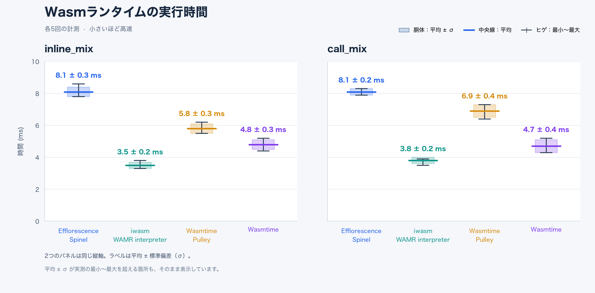

# New VM / Spinel comparison



These eight summary rows use the latest results supplied by the user, with five runs per row.
The body shows mean ± standard deviation, the central line shows the mean,
and whiskers show the observed minimum and maximum. Both panels use the same
millisecond scale. Mean ± standard deviation can extend beyond the observed
range; it is preserved without clipping. No quartiles or per-run values are
inferred from the summaries.

The supplied data are in `spinel_new_vm_summary.json` and `.csv`. PNG and SVG
exports are included. To regenerate on macOS with Matplotlib and the
Hiragino Kaku Gothic W3 system font installed:

```sh
python3 plot_spinel_comparison.py
```

Run from this directory, or pass the script's path from the repository root.
